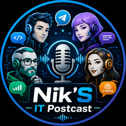

<div align="center">



# Новости АйТи

[](https://github.com/NikKurkov/it-podcast-bot/actions/workflows/tests.yml)
[](https://github.com/NikKurkov/it-podcast-bot/releases/latest)

[Слушать в Telegram](https://t.me/nik_podcast) · [Запустить у себя](#быстрый-запуск)

</div>

Бот собирает IT-новости из выбранных Telegram-каналов и превращает их в подкаст с несколькими ведущими. Сценарий и озвучка создаются на вашем компьютере. Готовый выпуск можно прослушать и отправить в Telegram вручную или по расписанию.

Исходные посты и результаты фактчекинга сохраняются рядом со сценарием. Если тему не удаётся подтвердить, бот пробует короткую версию и проверяет её снова. Выпуск может выйти с остальными темами, а прерванный запуск можно продолжить с сохранённых сцен.

## Быстрый запуск

На Linux нужны Python 3.11, `uv`, ffmpeg, systemd и Ollama.

```bash
cp .env.example .env
```

Укажите Telegram API ID и API Hash в `.env`, а каналы для сбора новостей — в `config/channels.txt`.

```bash
make setup
make ollama
ollama pull qwen2.5:7b-instruct
ollama pull qwen2.5:3b-instruct
make llm-check
make collect
make doctor
make podcast-preview
```

При первом `make collect` нужно войти в Telegram. `make podcast-preview` соберёт пробный выпуск с аудио без отправки. Файлы будут в `data/episodes/`.

`make setup` пересоздаёт `.venv` для CPU. В существующем окружении можно установить зависимости командой `uv pip install --python .venv/bin/python -r requirements-dev.txt`.

## Команды

| Команда | Что делает |
| --- | --- |
| `make podcast-script` | Сценарий из уже собранных новостей |
| `make podcast-audio` | Озвучка последнего сценария |
| `make podcast-check` | Проверка сценария и аудио |
| `make podcast-publish` | Отправка последнего готового выпуска |
| `make podcast-generate-and-publish` | Полный цикл с отправкой |
| `make podcast-scheduler-preview` | Показ настроек расписания |
| `make podcast-scheduler-install` | Ежедневная генерация и публикация в 07:00 |

Для отправки задайте `TELEGRAM_PUBLISH_CHANNEL_ID` и дайте подключённому аккаунту право публиковать в канале. Перед отправкой прослушайте выпуск и проверьте спорные утверждения по источникам.

## Настройки и документация

Пример настроек есть в [`.env.example`](.env.example). Стиль реплик задаётся в [`config/podcast_style.md`](config/podcast_style.md), произношение — в [`config/pronunciation_ru.txt`](config/pronunciation_ru.txt). По умолчанию речь озвучивает Silero на CPU. Доступны XTTS для речи и llama.cpp для сценария.

[Ручная сборка и публикация](docs/mvp_workflow.md) · [Архитектура и память](docs/architecture.md) · [Модели](docs/local-model-manifest.json) · [Изменения](CHANGELOG.md)
